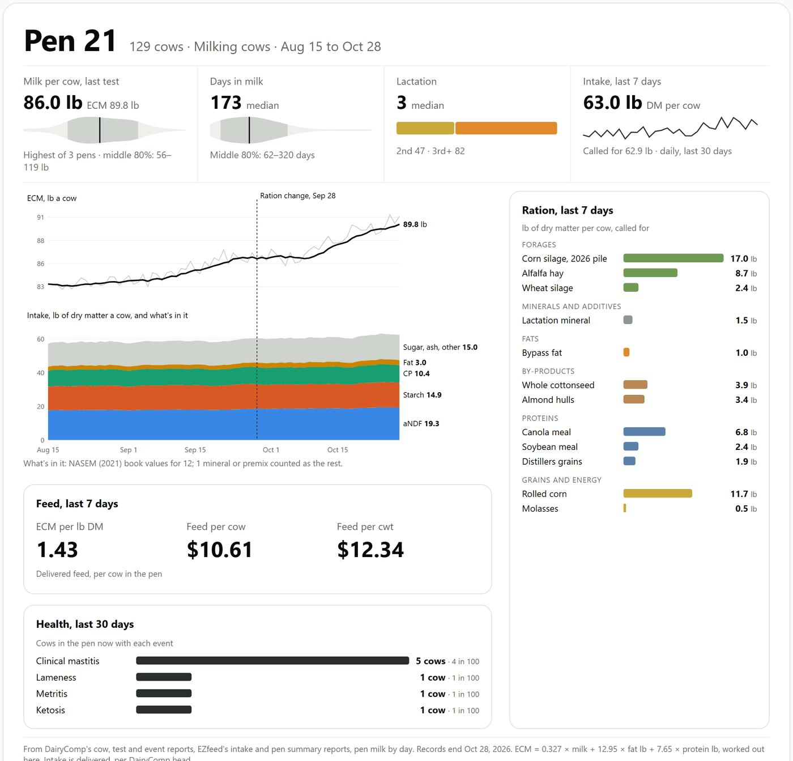
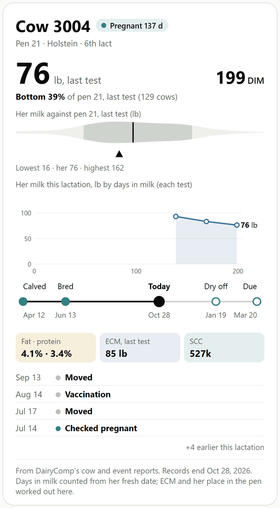
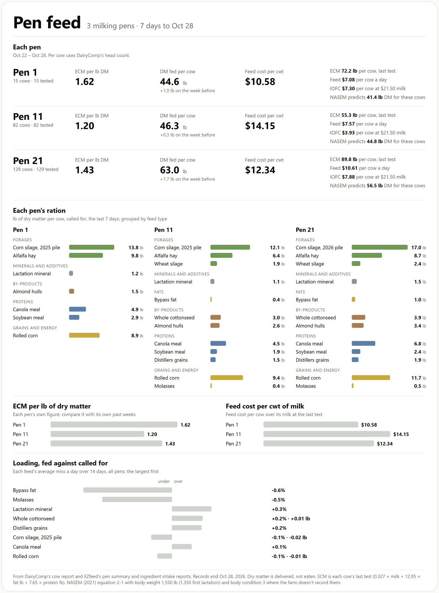
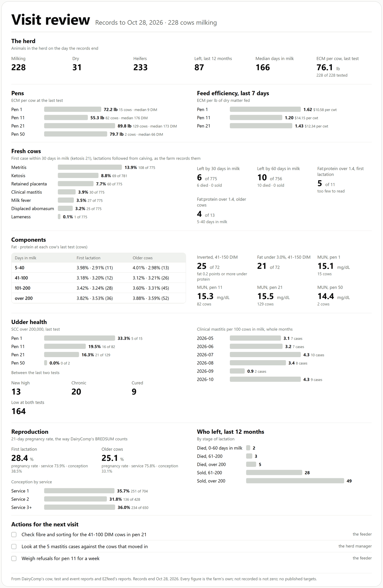
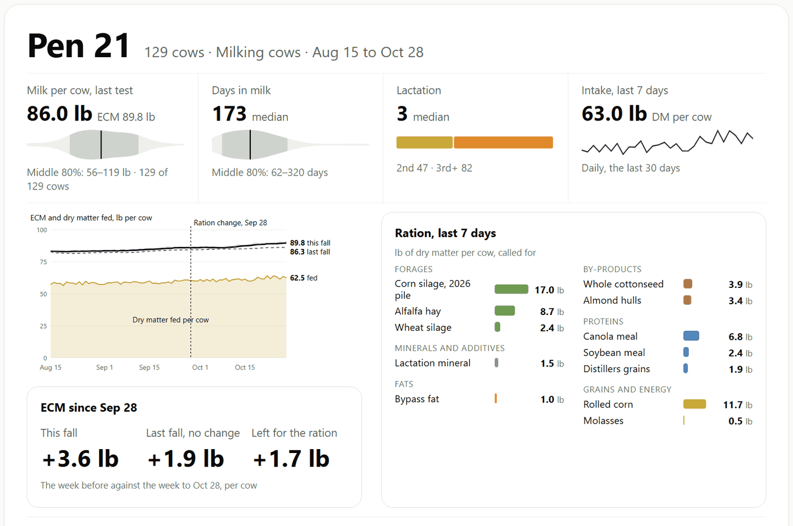

<div align="center">


# Dairy Data Tools

### A dairy's own DairyComp and EZfeed records, read by your AI assistant.

**Attach a farm's exports. Ask in plain words. Get each pen's numbers, worked out by tested scripts, not guessed.**

[](https://pypi.org/project/dairy-data-tools/)
[](https://doi.org/10.5281/zenodo.23493936)
[](LICENSE)

[Quick start](#quick-start) · [What you get](#what-you-get) · [Other apps](#other-apps) · [What's in it](#whats-in-it) · [Your files](#what-it-does-with-your-files)

Free, for dairy vets, nutritionists and consultants. By Pádraig Lucey, MVB, MPVM, Ph.D., DACVPM-Epi
([Dairy Data Science](https://dairydatascience.com)).

</div>

---

## Quick start

### 1. Add it to Claude

In the Claude app (desktop or [claude.ai](https://claude.ai), on a paid plan):

1. **Settings > Capabilities**: turn on **Code execution and file creation**. The scripts run in Claude's own sandbox.
2. **Customize > Plugins > Add marketplace**: enter `padge01/dairy-data-tools`, then add **Dairy Data Tools**.

Coming soon to Claude's plugin directory, for one-click install.

### 2. Ask

Attach the farm's DairyComp and EZfeed exports (or this kit's [sample herd](https://github.com/padge01/dairy-data-tools/tree/main/plugins/dairy-data-tools/sample-herd)) and
ask, for example:

```text
How is pen 21 doing?
```

You get the figures, where each came from and what it's out of, and a card like this one:

<p align="center"></p>

No DairyComp export yet? Ask *"What do I type in DairyComp to export what you need?"*. It writes the SHOW commands from
the farm's own item list.

## What you get

Each answer comes back as a card. These are from the sample herd. A six-page overview to share:
[dairy-data-tools-overview.pdf](https://github.com/padge01/dairy-data-tools/blob/main/docs/dairy-data-tools-overview.pdf).

<table>
<tr>
<td width="50%" valign="top"><b>A cow</b><br>Her milk this lactation, her place in the pen, what's happened to her.<br><br>
</td>
<td width="50%" valign="top"><b>Pen feed</b><br>Each pen's intake, efficiency, cost per cwt and ration side by side.<br><br>
</td>
</tr>
<tr>
<td valign="top"><b>Visit review</b><br>Fresh cows, components, udder health, reproduction, who left, and what to check next.<br><br>
</td>
<td valign="top"><b>On a slide</b><br>Add <code>--slide</code>: bigger, fewer items, sized for a talk or a meeting.<br><br>
</td>
</tr>
</table>

Herds that test get ECM from their tests. Herds that only weigh milk get each cow's daily weight, and the card says so.
Save the exports every day or every month and the cards join them into each pen's and each cow's milk over time.

## Other apps

| Where | How |
| --- | --- |
| **Claude Code** | `claude plugin marketplace add padge01/dairy-data-tools`, then `claude plugin install dairy-data-tools@dairy-data-tools` |
| **Codex, Cursor, Gemini CLI** and other apps that read Agent Skills | `npx skills add padge01/dairy-data-tools` |
| **Python, no AI** (Python 3.10 or later, nothing else to install) | `pip install dairy-data-tools`, then `dairy-data-tools pen --folder "Farm Exports" --pen 21`; `dairy-data-tools --help` lists every question |

## What's in it

Ask in plain words; the right skill picks itself. No commands to learn.

| Skill | Ask it | What it does |
| --- | --- | --- |
| dairycomp-exports | "How do I get my cow list out of DairyComp?" "Write me a list of fresh cows in pen 1." "Which of these items shouldn't I use?" | The reports to save for this farm; DairyComp commands from plain English, checked against the farm's own items (SHOW, never LIST, which prints); what each item is |
| ezfeed-exports | "Which EZfeed reports do you need?" | The reports to save and how they're read |
| herd-explorer | "How is pen 21 doing?" "What happened to cow 3004?" | The herd, every pen, one pen, one cow: milk and ECM as a spread, events, lactations |
| pen-feed | "What's pen 21's feed efficiency and IOFC?" "Is the feed loaded as called for?" | Each pen's cows joined to its feed: intake per cow, ECM per lb DM, cost per cwt, IOFC, NASEM's predicted intake; loading accuracy, refusals, consistency |
| weekly-review | "Get me ready for Thursday's visit." "How are the fresh cows doing?" | Fresh cows, components and MUN, udder health, reproduction, who left, the pens' feed, and actions for the next visit |
| ration-change | "Did pen 21's ration change work?" | The weeks before against the weeks after, with the same weeks last year or another pen taken out |
| balance-ration | "Balance pen 21's ration" | Runs the free Dairy Ration Lab when it's connected; this kit never makes up a ration |

**A sample herd** (`sample-herd/`): a made-up California dairy's exports, to try every skill before using a real farm's.

**Also from Dairy Data Science:** the **Dairy Ration Lab**, a free ration balancer, at https://lab.dairydatascience.com
(for agents: `https://mcp.dairydatascience.com`, sign in with Google), and **BESTPRED**, USDA's best prediction of
305-day and mature-equivalent milk, in this marketplace and at `https://bestpred.dairydatascience.com/mcp`.

## What it does with your files

- The scripts read the export files where they are. They change nothing, keep nothing, and send nothing over the
  internet. They use Python's standard library only.
- In Claude's chat the files you attach and the scripts run in Claude's own code sandbox. What the agent reads goes to
  the AI company as part of the conversation, as anything you attach does, unless you run a model on your own computer.
- Event remarks, protocols and technician names are left out of what the scripts report, because they are free text
  typed on the farm and could contain anything, including instructions aimed at an agent.
- Nothing reads DairyComp's own files or backups, and no figure DairyComp calculates for itself (such as 305-day or
  mature-equivalent milk) is used: the kit works from raw records.

## Good to know

- Weights are in pounds. Every count says what it's out of, and pens are compared with themselves and with the farm's
  other pens, never with published targets.
- It's a teaching and planning tool, not veterinary or nutrition advice: check anything before it changes what cows are
  fed.
- DairyComp 305 and EZfeed are Valley Ag Software's products; this project isn't affiliated with them.

## Cite it

If it helps your work, please cite it: Lucey, P. (2026). *Dairy Data Tools* [software]. Zenodo.
https://doi.org/10.5281/zenodo.23493936. GitHub's "Cite this repository" button gives the same reference.

## Licence

Code under Apache-2.0 (`LICENSE`); the skills' text under CC BY 4.0 (`LICENSE-skills.md`). The NASEM (2021) feed values
keep NASEM's own terms (see `NOTICE`). Questions and fixes:
[issues](https://github.com/padge01/dairy-data-tools/issues).

## Working on it

- `plugins/dairy-data-tools/`: the plugin people install (skills, sample herd, README, licences).
- `tools/dairy.py`, `tools/dairytools/` and the ration-change scripts in `tools/`: the one copy of the code;
  `python tools/sync_scripts.py` copies it into each skill and writes this README. `pyproject.toml` builds the same
  code as the `dairy-data-tools` package on PyPI.
- `tools/make_sample_herd.py`: writes the sample herd (fixed seeds, same files every run).
- `tests/`: `python -m pytest -q tests` (made-up files with known answers, the sample herd, the directory's file limits).
